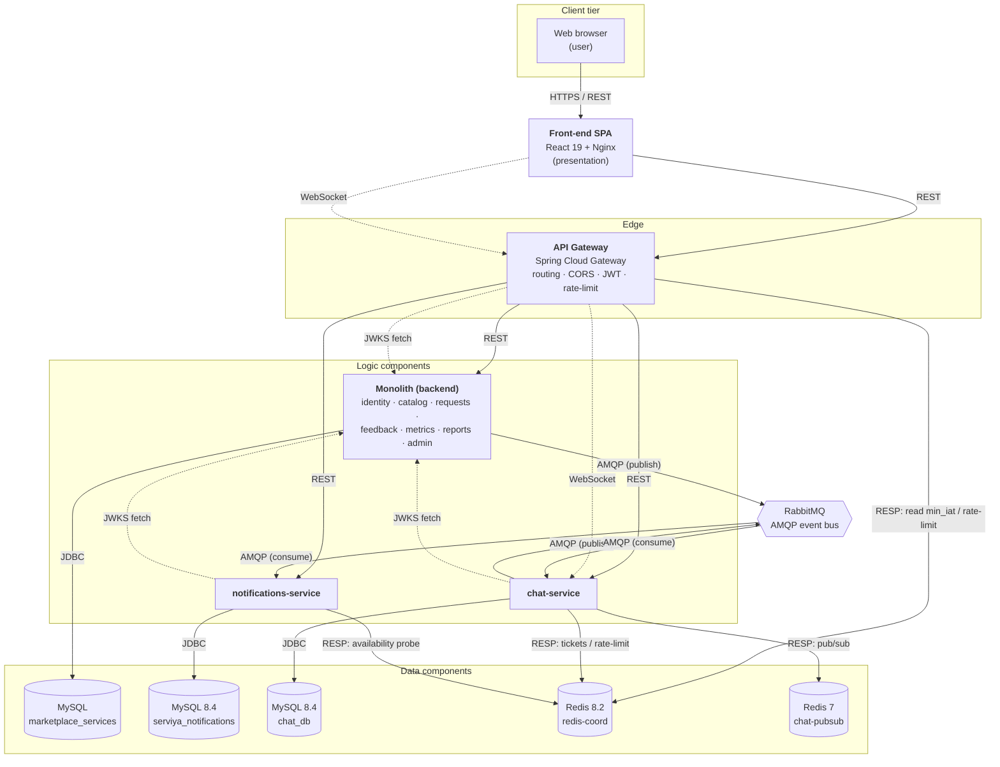
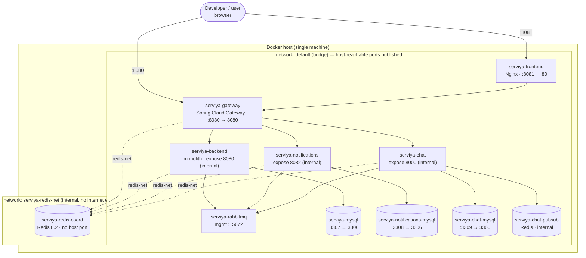
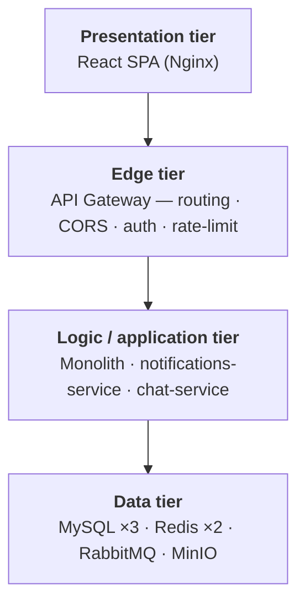
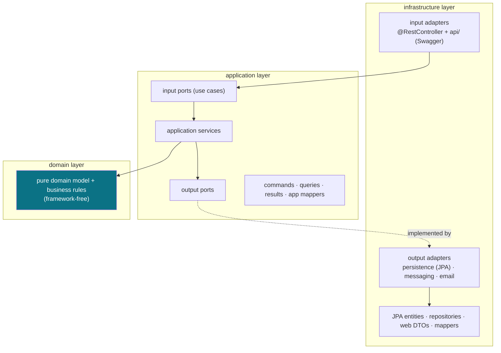
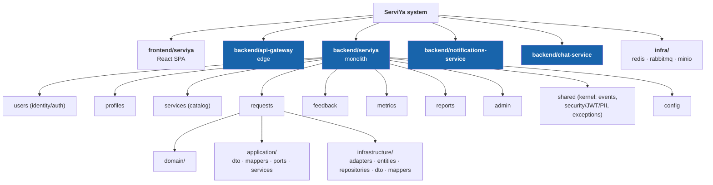

# Prototype 2 — Concrete Architectural Structures

> **Software Architecture — 2025-II · Universidad Nacional de Colombia**
> Delivery artifact. When copied into the `swarch2025ii` repository, this file goes under
> `project/prototype_2/<X>/README.md` (where `<X>` is the team name), together with the logo and the
> files needed for a local deployment.

---

## Team

| Field | Value                                                          |
|-------|----------------------------------------------------------------|
| **Team name** | ServiYa                                                        |
| **Members** | Juan Sanchez, Cristian Arcia, Fabian Rozo, Ana Sofia Rodriguez |


---

## Software System

### Name

**ServiYa**

### Logo


### Description

**ServiYa** is a **home-services marketplace**: clients hire offerers (service providers) to perform
services at a given address. The platform covers the full lifecycle — provider profiles and a service
catalog, service search, the service-request workflow (acceptance, rescheduling, completion),
bidirectional feedback (ratings + reviews), reputation metrics, reporting and content moderation, an
admin back office, asynchronous notifications (in-app + email) and real-time chat between the two
parties of a request.

The system is built as a **distributed application** orchestrated with Docker Compose. It started as a
modular monolith and is being **incrementally decomposed into microservices behind an API gateway**
(Strangler Fig). As of this prototype, two capabilities have already been carved out into independent
services with their own databases — **notifications** and **chat** — while the remaining business
capabilities still live in a single hardened backend ("the monolith"). Every HTTP request enters
through a single edge (the **API gateway**), which owns routing, CORS, authentication (ES256 JWT
verified against a JWKS) and rate limiting.

**Technology at a glance**

| Concern | Technology |
|---------|-----------|
| Front-end (presentation) | React 19 + Vite (JavaScript), served by Nginx |
| API gateway (edge) | Spring Cloud Gateway (Spring WebFlux, reactive), Java 21 |
| Logic services | Spring Boot 3.5.5, Java 21 (hexagonal architecture) |
| Relational data | MySQL 8.4 (one database **per** service) |
| Coordination / cache (NoSQL) | Redis 8.2 (coordination), Redis 7 (chat pub/sub) |
| Messaging | RabbitMQ 4.1 (AMQP event bus) |
| Object storage (optional) | MinIO (S3-compatible, chat attachments) |
| Security | ES256 JWT + JWKS, AES-256-GCM for PII, refresh-token rotation |
| Deployment | Docker / Docker Compose (container-oriented) |

**Programming languages:** Java (all backend services) and JavaScript (front-end) — two different
general-purpose languages.

---

## Architectural Structures

Four structures are documented below, each with its view, its elements and relations, and the
architectural styles/patterns it embodies.

### 1. Component-and-Connector (C&C) Structure

The C&C view shows the system **at runtime**: the components that execute and the connectors through
which they interact.

#### C&C View



#### Architectural elements and relations

**Components**

| Component | Type | Responsibility |
|-----------|------|----------------|
| **Front-end SPA** | Presentation | React 19 single-page app (built with Vite, served by Nginx). Renders all UI; holds the access token in memory and the refresh token in an HttpOnly cookie. |
| **API Gateway** | Logic (edge) | The **single public HTTP entry point**. Path-based routing to the backing services, centralized CORS, ES256 JWT verification (via JWKS) with `min_iat` revocation checks, global + per-endpoint auth rate limiting, correlation-id injection and error normalization. |
| **Monolith (`backend`)** | Logic | The still-monolithic core: `users` (identity/auth — **issues** the ES256 tokens and **serves the JWKS**), `profiles`, `services` (catalog), `requests`, `feedback`, `metrics`, `reports`, `admin`. Publishes notification/chat-relevant events to the bus via a transactional **outbox**. |
| **notifications-service** | Logic | Independent microservice: consumes events from RabbitMQ, persists an in-app inbox, sends email (Brevo), and retries failed deliveries on a schedule. Exposes its REST inbox **only through the gateway**. |
| **chat-service** | Logic | Independent microservice: real-time 1-to-1 chat for a service request over WebSocket; persists messages, fans messages out across instances via Redis Pub/Sub, publishes chat events to the bus. |
| **MySQL × 3** | Data (relational) | **Database-per-service**: `marketplace_services` (monolith), `serviya_notifications`, `chat_db`. No service reads another service's database. |
| **redis-coord** | Data (NoSQL, key-value) | Shared **coordination** substrate: token-revocation watermark (`min_iat`), distributed rate-limiting counters and scheduler locks. Per-service Redis ACL users. Reachable only on the internal network. |
| **chat-pubsub** | Data (NoSQL, key-value) | Ephemeral Redis **Pub/Sub** channel used only to broadcast chat messages between chat-service instances. No persistence. |
| **RabbitMQ** | Connector infra | The asynchronous **event bus** between services. |
| **MinIO** *(optional)* | Data (object store) | S3-compatible storage for chat attachments (enabled via the `minio` Compose profile). |

**Connectors** (the prototype uses several connector *types*, among them two distinct HTTP-based ones):

| Connector | Type | Where it is used |
|-----------|------|------------------|
| **REST over HTTP** | Synchronous request/response (HTTP) | browser → gateway → every service |
| **WebSocket** | Full-duplex streaming (HTTP upgrade) | browser → gateway → chat-service (live chat) |
| **AMQP** | Asynchronous publish/subscribe messaging | monolith/chat → RabbitMQ → notifications/chat |
| **JDBC** | Database protocol | each service → its own MySQL |
| **RESP (Redis protocol)** | Key-value / pub-sub | services → redis-coord & chat-pubsub |

**Key relations**

- Everything client-facing crosses the **gateway**; the monolith and the extracted services are **not
  published to the host** — they are only reachable on the internal Docker network.
- Authentication is **decoupled from authorization of identity data**: the monolith is the only **token
  issuer** and the only holder of the private signing key; the gateway and the other services are
  **resource servers** that verify tokens by fetching the issuer's public keys (**JWKS**) over the
  internal network. There is no shared symmetric secret.
- Cross-service workflows (e.g. "notify the user") are **asynchronous and decoupled** through the bus,
  so a slow or down notifications-service never blocks a business transaction (the outbox buffers it).

#### Architectural styles and patterns

- **Client–Server** — browser/SPA against server-side services.
- **API Gateway** (edge / single entry point) — routing, cross-cutting security and CORS at one place.
- **Microservices + Strangler Fig** — independently deployable services (`notifications`, `chat`) carved
  out of a modular monolith that is being progressively strangled.
- **Database per Service** (shared-nothing data) — each service owns its schema; no cross-service DB
  access.
- **Publish–Subscribe / Event-Driven** — RabbitMQ decouples producers from consumers.
- **Transactional Outbox** — the monolith publishes events atomically with its local transaction.
- **Token-based security with an external identity (JWT + JWKS)** — resource-server pattern; asymmetric
  signatures (ES256), key rotation and `min_iat` revocation.
- **Sidecar coordination substrate** — Redis as a shared primitive for rate limiting and locks.

---

### 2. Deployment Structure

The deployment view maps the runtime components onto **execution nodes** — here, Docker containers on a
single host, wired by two Docker networks — and shows published ports.

#### Deployment View



#### Architectural elements and relations

- **Nodes = containers.** Each logical component runs in its own Docker container with a fixed
  `container_name`; images are either built from the repo (`gateway`, `backend`, `notifications-service`,
  `chat-service`, `frontend`) or pulled (`mysql`, `redis`, `rabbitmq`, `minio`).
- **Two networks.**
  - `default` (bridge) carries normal east-west traffic and the few **host-published** ports.
  - `serviya-redis-net` is declared **`internal: true`** (no route to the internet); only the
    coordination traffic to `redis-coord` flows here, which is why `redis-coord` has **no host port**.
- **Published ports (host → container).** `frontend` `8081→80`, `gateway` `8080→8080`, `rabbitmq`
  management `15672`, and the three MySQL instances on `3307/3308/3309` (for debugging only). The
  monolith (`8080`), notifications (`8082`) and chat (`8000`) are **`expose`-only** — unreachable from
  the host, only via the gateway. Management/metrics endpoints run on a **separate, unpublished** port
  (`9090`).
- **Startup ordering & resilience.** `depends_on` + health checks order the boot (services wait for
  their MySQL/RabbitMQ to be healthy); `restart: on-failure` covers the race where MySQL passes its
  socket health check before accepting TCP. Services tolerate a missing `redis-coord` at boot
  (lazy connections, fail-open).
- **State lives in named volumes** (`mysql_data`, `notifications_mysql_data`, `chat_mysql_data`,
  `rabbitmq_data`, `redis-coord-data`, `minio_data`), so a container restart keeps its data; deleting a
  volume reseeds from scratch.
- **Schema provisioning** differs by node: the monolith MySQL is seeded from mounted SQL on a clean
  volume; `notifications` and `chat` run **Flyway** migrations at service startup.

#### Architectural patterns used

- **Container-oriented / multi-container deployment** orchestrated by **Docker Compose**.
- **Database per Service** materialized as three separate database containers.
- **Network segmentation** — a dedicated **internal** network isolates the coordination substrate.
- **Health-check-gated startup** and **supervised restart** for ordering and self-healing.
- **Externalized configuration & secrets** via environment variables / `.env` (12-factor style).
- **Single edge exposure** — only the gateway (and the static front-end) are reachable from outside.

---

### 3. Layered Structure

Two complementary layerings coexist: a **system-wide** tiering across the distributed system, and the
**per-service** hexagonal layering inside every Java service.

#### Layered View

**(a) System-wide tiers**



**(b) Per-service hexagonal layering (ports & adapters), e.g. inside the monolith**



#### Architectural elements and relations

- **System tiers** are strictly ordered: the presentation tier talks only to the edge; the edge is the
  only tier that fans out to the logic tier; each logic service talks only to its **own** slice of the
  data tier. There is **no tier-skipping** from the browser to a service or a database.
- **Inside each service**, the dependency rule points inward:
  `infrastructure → application → domain`.
  - **domain** — pure business model and rules, no framework dependencies.
  - **application** — use-case interfaces (**input ports**), application services, and **output ports**
    (interfaces the domain needs the outside world to fulfil, e.g. persistence). DTOs here are
    `Command`/`Query`/`Result`.
  - **infrastructure** — REST controllers (input adapters), persistence/messaging/email **output
    adapters**, JPA entities, repositories and web DTOs (`Form`/`Response`). Controllers and adapters
    depend on **ports**, never on each other.
- The domain never imports Spring; adapters are replaceable without touching business logic — the port
  interfaces are the seams along which the monolith is being split into services.

#### Architectural patterns used

- **Layered (N-tier) architecture** at the system scale (presentation / edge / logic / data).
- **Hexagonal architecture (Ports & Adapters)** inside every service, enforcing the inward dependency
  rule and isolating the domain.
- **DTO / mapping per layer** (MapStruct) to keep web, application and domain models decoupled.
- **CQRS-flavored reads** — dedicated read-models/queries for list and detail views.

---

### 4. Decomposition Structure

The decomposition view shows how the system is broken down into **units of implementation** (modules),
recursively, independent of runtime.

#### Decomposition View



#### Architectural elements and relations

- **Top level** — the monorepo decomposes into five deployable units (front-end, gateway, monolith,
  notifications-service, chat-service) plus an **`infra/`** unit that holds the shared-infrastructure
  definitions (Redis, RabbitMQ, MinIO compose fragments, ACLs).
- **The monolith** decomposes into **9 business modules** (`users`, `profiles`, `services`, `requests`,
  `feedback`, `metrics`, `reports`, `admin`) plus a **`shared`** kernel (application events,
  security/JWT/PII, exceptions + handlers, text filtering, stats) and `config`. `admin` is an
  orchestrator with no persistence of its own. The front-end mirrors this module structure under
  `src/modules/`.
- **Each module** decomposes again into the three hexagonal packages — `domain/`, `application/`
  (`dto`, `mappers`, `ports/input`, `ports/output`, `services`) and `infrastructure/`
  (`adapters/input`, `adapters/output`, `entities`, `repositories`, `dto`, `mappers`). The diagram
  expands `requests` as the representative example.
- **Uses relations** between modules are deliberate and inform the migration order: a tightly-coupled
  cluster (`profiles ↔ services ↔ {metrics, feedback}`) is intended to move as one coarse-grained unit,
  while leaf modules (notifications, then metrics, …) are extracted first — `notifications` and `chat`
  already are.

> **Styles/patterns** at this level: **modular decomposition by business capability (vertical slices)**,
> a **shared-kernel** module for cross-cutting concerns, and alignment of decomposition units with
> future deployment units (each module is a candidate microservice).

---

## Prototype — Local Deployment Instructions

The whole system runs with **Docker** and **Docker Compose**; no local JDK/Node is required to run it.

### Prerequisites

- **Docker** and **Docker Compose v2** (`docker compose …`).
- Git (to clone the repository).
- A POSIX shell for the one-time Redis ACL step (Git Bash on Windows, or WSL).

### Step 1 — Configure environment variables

From the repository root, create a `.env` from the template and fill in the required secrets:

```bash
cp .env.example .env
```

The application **fails fast** if critical secrets are missing or weak. At minimum set, in `.env`:

- **Database passwords:** `DB_PASSWORD`, `MYSQL_ROOT_PASSWORD`, `NOTIFICATIONS_DB_PASSWORD`,
  `NOTIFICATIONS_MYSQL_ROOT_PASSWORD`, `CHAT_DB_PASSWORD`, `CHAT_DB_ROOT_PASSWORD`.
- **JWT ES256 key pair** (`JWT_PRIVATE_KEY`, `JWT_PUBLIC_KEY`) — base64 of the DER, generated with
  OpenSSL (commands are documented in `.env.example`):

  ```bash
  openssl ecparam -name prime256v1 -genkey -noout -out ec-priv.pem
  openssl pkcs8 -topk8 -nocrypt -in ec-priv.pem -out ec-priv-pkcs8.pem
  # JWT_PRIVATE_KEY = base64 DER:
  grep -v -- ----- ec-priv-pkcs8.pem | tr -d '\n'
  openssl ec -in ec-priv.pem -pubout -out ec-pub.pem
  # JWT_PUBLIC_KEY = base64 DER:
  grep -v -- ----- ec-pub.pem | tr -d '\n'
  ```

- **Encryption / shared keys** (≥ 32 random chars each): `ENCRYPTION_KEY`, `NOTIFICATIONS_PAYLOAD_KEY`
  (must be identical in monolith and notifications), `NOTIFICATIONS_ENCRYPTION_KEY`.
- **RabbitMQ:** `RABBITMQ_PASSWORD`, `CHAT_RABBITMQ_PASSWORD`.
- Email is **off by default** (`EMAIL_ENABLED=false`); leave it off to run without a Brevo account.
- The `REDIS_*` passwords already have working dev defaults in `.env.example`.

### Step 2 — Render the Redis coordination ACL (one time)

```bash
cd infra/redis/acl
./render-acl.sh users.coord.acl.tpl users.coord.acl
cd ../../..
```

### Step 3 — Build and start the whole stack

The coordination Redis lives in a separate Compose file that must be **merged** with the root one:

```bash
docker compose \
  -f docker-compose.yml \
  -f infra/redis/docker-compose.redis.yml \
  up --build
```

> To run the core stack **without** the coordination substrate (functional, with rate-limiting/locks
> degraded to fail-open), you can use just `docker compose up --build`. The merged command above is the
> recommended, complete setup.

First boot takes a few minutes (Maven builds + MySQL initialization). Services with `restart: on-failure`
may restart once or twice while their databases become ready — this is expected.

### Step 4 — Access the system

| Surface | URL |
|---------|-----|
| **Web application** (front-end) | <http://localhost:8081> |
| **API gateway** (all `/api/**`) | <http://localhost:8080> |
| RabbitMQ management console | <http://localhost:15672> |

Create a fresh account from the web UI (seed users have placeholder passwords). All API traffic —
including WebSocket chat — goes through the gateway on `:8080`.

### Optional — chat attachments (MinIO)

```bash
docker compose --profile minio up -d minio minio-init
```

### Reset to a clean state

Stop and remove containers **and volumes** to reseed every database from scratch:

```bash
docker compose -f docker-compose.yml -f infra/redis/docker-compose.redis.yml down -v
```

---

## Files included for local deployment

When this folder is submitted to `swarch2025ii/project/prototype_2/<X>/`, include (besides this
`README.md` and `logo.svg`) the source and configuration needed to deploy: `docker-compose.yml`,
`infra/redis/docker-compose.redis.yml`, `.env.example`, and the service folders under `backend/` and
`frontend/` (or a reference/link to this repository at the delivered commit).
