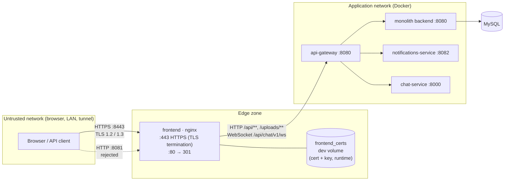

# ServiYa — Extracción del microservicio de notificaciones

Este documento explica **qué se hizo, por qué y cómo usarlo** al separar el módulo de notificaciones del monolito
en un **microservicio independiente**, con un **API gateway** delante. Es el primer paso de la migración a
microservicios definida en [`ESTADO-ACTUAL-Y-PLAN-FUTURO.md`](ESTADO-ACTUAL-Y-PLAN-FUTURO.md) (§7.4, paso 1).

> La referencia técnica completa (contrato del mensaje, modos de fallo, migración de datos) está en
> [`documents/microservicios/notifications-service.md`](documents/microservicios/notifications-service.md).
> Este README es la versión explicada para leer de corrido.
>
> **Lab 04 — Security (2026-II):** this repository also implements the **Secure Channel**
> pattern at the edge. See [Lab 04 — Security: Secure Channel](#lab-04--security-secure-channel-2026-ii)
> at the end of this document, and the captured evidence in
> [`docs/lab04/`](docs/lab04/).

---

## Índice

1. [La idea en una frase](#1-la-idea-en-una-frase)
2. [Cómo estaba antes](#2-cómo-estaba-antes)
3. [Análisis de dependencias](#3-análisis-de-dependencias)
4. [Cómo quedó ahora](#4-cómo-quedó-ahora)
5. [Las piezas nuevas, una por una](#5-las-piezas-nuevas-una-por-una)
6. [El viaje de una notificación, paso a paso](#6-el-viaje-de-una-notificación-paso-a-paso)
7. [Decisiones de diseño y por qué](#7-decisiones-de-diseño-y-por-qué)
8. [Seguridad](#8-seguridad)
9. [Qué pasa cuando algo falla](#9-qué-pasa-cuando-algo-falla)
10. [Cómo ejecutarlo](#10-cómo-ejecutarlo)
11. [Variables de entorno](#11-variables-de-entorno)
12. [Cómo probar que todo funciona](#12-cómo-probar-que-todo-funciona)
13. [Pruebas automáticas](#13-pruebas-automáticas)
14. [Bug importante encontrado en `main`](#14-bug-importante-encontrado-en-main)
15. [Lista de archivos que cambiaron](#15-lista-de-archivos-que-cambiaron)
16. [Pendientes](#16-pendientes)

---

## 1. La idea en una frase

Antes, las notificaciones eran **una parte más del monolito**. Ahora son **un programa aparte**, con su propia base
de datos, que recibe los pedidos de notificación por un **bus de mensajes (RabbitMQ)**. Todo el tráfico del
navegador entra por un **API gateway** que decide a quién mandar cada petición.

---

## 2. Cómo estaba antes

```
Navegador ──▶ nginx ──▶ MONOLITO (todo junto: usuarios, servicios, solicitudes, ..., notificaciones)
                              │
                              └──▶ una sola base de datos MySQL
```

- Cuando pasaba algo (registro, solicitud aceptada, baneo…), el código llamaba directamente a
  `notificationService.notify(...)`, **en memoria y dentro de la misma transacción**.
- Las tablas `notifications`, `notification_channels` y `notification_deliveries` vivían en la misma base de datos
  que todo lo demás.
- No existía ningún API gateway: el nginx del frontend mandaba todo directo al monolito.

---

## 3. Análisis de dependencias

Antes de separar algo hay que saber **de qué depende** y **quién depende de él**. Esto fue lo que se encontró.

### 3.1 Lo que el módulo de notificaciones usaba de otros (dependencias salientes)

| Usaba… | ¿Para qué? | ¿Cómo se resolvió? |
|---|---|---|
| Módulo `users` | Obtener el correo del destinatario para enviar el email | El monolito busca el correo y lo **manda dentro del mensaje**. El servicio ya no necesita a `users`. |
| `CurrentUser` (kernel `shared`) | Saber quién está logueado | El servicio valida el **JWT** por su cuenta. |
| `DistributedLock` (Redis) | Que el reintento programado no corra dos veces | Se reemplazó por `SELECT … FOR UPDATE SKIP LOCKED` en su propia base de datos. |
| `CoordinationAvailability` (Redis) | Saber si Redis está caído para aplazar correos | Se movió al servicio, que era su único usuario. |
| Publicador de eventos y excepciones de `shared` | Uso interno | El servicio tiene sus propias versiones. |

**Conclusión:** era una "hoja" del sistema. Solo tenía **una** dependencia de negocio (`users`), por eso es el
mejor candidato para ser el primer microservicio.

### 3.2 Quién usaba el módulo de notificaciones (dependencias entrantes)

Solo se usaba a través de **un método**: `NotificationServicePort.notify(...)`, desde 4 módulos:

| Módulo | Ejemplos de notificación |
|---|---|
| `users` | bienvenida, rol adquirido, recuperar contraseña, contraseña cambiada, cuenta eliminada |
| `requests` | solicitud creada / aceptada / cancelada, propuestas de reprogramación, vencimientos |
| `reports` | reporte recibido, reporte resuelto |
| `admin` | baneo, revocación de rol, moderación |

### 3.3 Base de datos y frontend

- La única relación con otras tablas era una **llave foránea de `notifications.user_id` a `users`**. Se eliminó,
  porque ahora `users` vive en otra base de datos.
- El frontend usaba 3 endpoints (`GET /api/v1/notifications`, `POST /api/v1/notifications/{id}/read` y
  `GET /api/v1/notification-channels`). **Se conservaron idénticos**, por eso el frontend **no cambió**.

---

## 4. Cómo quedó ahora

```
                                       ┌──────────────────────────────────────────────┐
 Navegador ──▶ nginx (:8081) ──▶ API GATEWAY (:8080)                                    │
                                       │                                               │
               /api/v1/notifications/**│                     todo lo demás             │
                                       ▼                           ▼                   │
                        ┌─────────────────────────┐     ┌──────────────────────┐       │
                        │  notifications-service  │     │      MONOLITO        │       │
                        │  (microservicio nuevo)  │     │ users, services,     │       │
                        │  puerto 8082            │     │ requests, reports... │       │
                        └───────────┬─────────────┘     └──────────┬───────────┘       │
                                    │                              │                   │
                        BD propia:  │                    BD propia:│                   │
                        serviya_notifications           marketplace_services          │
                                    ▲                              │                   │
                                    │        RabbitMQ              │ outbox            │
                                    └──────── (bus) ◀──────────────┘                   │
                                                                                       │
 Brevo (correo) ◀── notifications-service                                              │
```

**En palabras simples:**
1. El **gateway** es la puerta de entrada. Las peticiones de notificaciones van al microservicio y todo lo demás al monolito.
2. Cuando el monolito quiere notificar algo, **deja una nota** en una tabla (el *outbox*).
3. Un proceso del monolito **lleva esas notas a RabbitMQ** (el "cartero").
4. El microservicio **recoge las notas**, las guarda en su base de datos, las muestra en la bandeja del usuario y envía los correos.

---

## 5. Las piezas nuevas, una por una

### 5.1 `backend/notifications-service/` — el microservicio

Una aplicación Spring Boot independiente (Java 21, Spring Boot 3.5.5) con arquitectura hexagonal, igual que el monolito.

| Qué hace | Clase principal |
|---|---|
| Escucha los mensajes de RabbitMQ y los convierte en notificaciones | `NotificationRequestedListener` |
| Registra la notificación y la entrega por cada canal (INTERNAL / EMAIL) | `NotificationService`, `NotificationDeliveryService` |
| Expone la bandeja del usuario (los mismos 3 endpoints de antes) | `NotificationController` |
| Envía correos por Brevo (nunca lanza excepciones) | `EmailApiAdapter` |
| Reintenta cada 15 min los correos que fallaron (máximo 3 intentos) | `NotificationRetryScheduler` |
| Valida el JWT que emite el monolito | `JwtTokenVerifier`, `JwtAuthenticationFilter` |
| Crea su propio esquema de base de datos | Flyway: `db/migration/V1__init_notifications_schema.sql` |

**Su base de datos (`serviya_notifications`)** tiene las mismas 3 tablas de antes, con algunos cambios:
- `source_event_id`: el id del mensaje que creó la notificación. Es **único**, para no crear dos veces la misma notificación si el mensaje llega repetido.
- `recipient_email`: el correo del destinatario, **cifrado**, para poder reintentar el envío.
- `version`: control de concurrencia (bloqueo optimista).
- **Sin** la llave foránea a `users`.

### 5.2 `backend/api-gateway/` — la puerta de entrada

Una aplicación **Spring Cloud Gateway**. No tiene lógica de negocio: solo **enruta** y resuelve **CORS**.

| Ruta | Va a… |
|---|---|
| `/api/v1/notifications`, `/api/v1/notifications/**`, `/api/v1/notification-channels` | `notifications-service` |
| Todo lo demás (`/**`) | monolito |

- Escucha en el puerto **8080**, el mismo que antes usaba el monolito. Por eso el frontend sigue apuntando al mismo sitio.
- Es la **única autoridad de CORS**: quita la cabecera `Origin` antes de reenviar, así los servicios de atrás no aplican sus propias reglas y no hay conflictos.
- Las rutas están en `application.yaml`. Cuando se extraiga el siguiente microservicio (por ejemplo `metrics`), solo hay que **añadir una ruta**.

### 5.3 Cambios en el monolito (`backend/serviya/`)

Lo más importante: **la firma de `notify(...)` no cambió**, así que **ninguno de los 12 servicios que notifican
tuvo que modificarse**.

Lo que cambió por dentro:

| Antes | Ahora |
|---|---|
| `NotificationService` guardaba la notificación y enviaba el correo | `NotificationService` **arma un pedido** y lo guarda en la tabla `notification_outbox` |
| 40 archivos (entidades, controlador, email, scheduler…) | Se borraron. Queda solo el "cliente": puerto, outbox y relay |
| — | `NotificationOutboxRelayScheduler` + `NotificationOutboxPublisher`: cada segundo leen el outbox y lo publican en RabbitMQ |
| — | `PayloadSealer`: cifra el correo y los datos sensibles antes de publicarlos |
| — | `UserRecipientEmailAdapter`: busca el correo del usuario |
| Rutas de notificaciones en `SecurityConfig` | Se quitaron (ahora las atiende el microservicio) |
| Configuración de correo (`serviya.email`) | Se movió al microservicio |

### 5.4 Infraestructura (`docker-compose.yml`)

Se añadieron 4 contenedores:

| Contenedor | Para qué | Puerto en tu PC |
|---|---|---|
| `serviya-gateway` | API gateway | **8080** |
| `serviya-notifications` | El microservicio | (no se publica; se entra por el gateway) |
| `serviya-notifications-mysql` | Base de datos del microservicio | 3308 |
| `serviya-rabbitmq` | Bus de mensajes + consola web | 15672 (consola) |

Además:
- El **monolito ya no se publica** en el puerto 8080: ahora se entra por el gateway.
- El **nginx del frontend** apunta al gateway en vez de al monolito.
- **Redis**: se creó un usuario `svc-notifications-coord` que **solo puede hacer `PING`**. El microservicio lo usa para saber si Redis está caído.

---

## 6. El viaje de una notificación, paso a paso

Ejemplo: **Ana se registra** en ServiYa.

1. **Monolito:** `UserAuthenticationService` crea la cuenta y llama a `notify(..., "¡Bienvenido a ServiYa!", ...)`, igual que antes.
2. **Monolito:** `NotificationService` busca el correo de Ana, lo cifra y guarda un registro en `notification_outbox`.
   Esto pasa **en la misma transacción** que el registro: si el registro falla, la notificación tampoco se crea.
3. **Monolito:** como máximo 1 segundo después, el relay toma ese registro, lo publica en RabbitMQ, **espera la
   confirmación** del broker y recién entonces lo borra del outbox.
4. **RabbitMQ:** guarda el mensaje en la cola `notifications-service.notification-requested`.
5. **Microservicio:** `NotificationRequestedListener` recoge el mensaje, lo valida y descifra el correo.
6. **Microservicio:** revisa si ese mensaje ya se procesó (por su `eventId`). Si es nuevo, guarda la notificación
   con una entrega por canal: INTERNAL queda `SENT` al instante y EMAIL queda `PENDING`.
7. **Microservicio:** cuando la transacción termina, envía el correo por Brevo. Si funciona queda `SENT`; si falla, `FAILED`.
8. **Navegador:** Ana abre "Notificaciones". La petición pasa por el gateway, que la manda al microservicio, y Ana ve su bienvenida.

---

## 7. Decisiones de diseño y por qué

| Decisión | Alternativa que se descartó | Por qué |
|---|---|---|
| **RabbitMQ + outbox** | Llamada HTTP directa del monolito al servicio | Con HTTP, si el microservicio está caído, el registro (o la solicitud, o el baneo) fallaría o la notificación se perdería. Con el outbox, la notificación se guarda junto con la operación de negocio y sale cuando se pueda. |
| **El correo viaja en el mensaje** | Que el microservicio le pregunte el correo al monolito | Así el microservicio no depende del monolito para funcionar. |
| **Base de datos propia** | Seguir usando la misma base de datos | Un microservicio "de verdad" es dueño de sus datos. Compartir la base los dejaría pegados. |
| **Flyway** para el esquema | `ddl-auto: update` (lo que usa el monolito) | El esquema queda versionado y es reproducible (mejora M25 del plan). |
| **`SKIP LOCKED`** para no duplicar trabajo | Lock distribuido en Redis | Si hay 2 copias del servicio, cada fila la procesa solo una, y sin depender de Redis. |
| **API gateway desde ya** | Una regla extra en nginx | El gateway es requisito de la entrega (§7.0) y sirve para todos los microservicios futuros. |

Estas decisiones se tomaron con el equipo antes de implementar.

---

## 8. Seguridad

- **Datos sensibles cifrados en tránsito:** el correo y el enlace de recuperación de contraseña (que contiene un
  token) se cifran con **AES-256-GCM** antes de entrar al outbox y a RabbitMQ. Se usa la clave compartida
  `NOTIFICATIONS_PAYLOAD_KEY`. Así se mantiene la regla original del sistema: *el token nunca se guarda en claro*.
- **Correo cifrado en reposo:** en la base del microservicio, `recipient_email` también está cifrado, con su propia clave (`NOTIFICATIONS_ENCRYPTION_KEY`).
- **JWT:** el microservicio **solo verifica** los tokens que emite el monolito (mismo `JWT_SECRET`).
- **Todo cerrado por defecto:** cualquier ruta del microservicio que no esté declarada responde **403**. Es lo contrario del monolito, que deja abierto todo lo no declarado.
- **Cada usuario solo ve lo suyo:** nadie puede ver ni marcar las notificaciones de otro.
- **Arranque seguro:** si falta una clave o es débil (menos de 32 caracteres o un valor de ejemplo), el servicio **se niega a arrancar** a propósito.

---

## 9. Qué pasa cuando algo falla

| Si… | Entonces… |
|---|---|
| La operación de negocio falla (rollback) | La notificación tampoco sale. |
| **RabbitMQ se cae** | La app **sigue funcionando**. Las notificaciones esperan en el outbox y salen solas cuando RabbitMQ vuelve. |
| **El microservicio se cae** | Los mensajes esperan en la cola de RabbitMQ. La bandeja da error hasta que el servicio vuelva. |
| Llega el mismo mensaje dos veces | Se ignora el repetido (se reconoce por su `eventId`). |
| Llega un mensaje roto o inválido | Va a una cola especial, la **DLQ** (`...dlq`), sin reintentos inútiles, para revisarlo a mano. |
| La base de datos falla un momento | Se reintenta 4 veces con espera creciente; si sigue fallando, el mensaje va a la DLQ. |
| Brevo falla al enviar un correo | La entrega queda `FAILED` y se reintenta cada 15 min (máximo 3 intentos). El correo de "recuperar contraseña" **no** se reintenta, porque sin el enlace no sirve. |
| Redis se cae | Los correos se aplazan hasta que vuelva (protocolo D-07/1a). |

> ⏱ **Un cambio que se nota:** la notificación aparece en la bandeja **alrededor de 1 segundo después** de la
> acción, no al instante. Es normal en sistemas distribuidos y se llama *consistencia eventual*.

---

## 10. Cómo ejecutarlo

**Requisito:** Docker Desktop abierto y un archivo `.env` completo (ver sección 11).

```bash
# 1) La primera vez: generar el archivo de usuarios de Redis (en Git Bash)
set -a; . ./.env; set +a
(cd infra/redis/acl && sh ./render-acl.sh users.coord.acl.tpl users.coord.acl)

# 2) Levantar todo (con Redis)
docker compose -f docker-compose.yml -f infra/redis/docker-compose.redis.yml up -d --build

# 3) Ver que estén los 8 contenedores en "Up"
docker ps
```

| Qué | Dónde |
|---|---|
| La app (frontend) | http://localhost:8081 |
| La API (a través del gateway) | http://localhost:8080 |
| Swagger del monolito | http://localhost:8080/swagger-ui/index.html |
| Consola de RabbitMQ | http://localhost:15672 (usuario `serviya`, contraseña `RABBITMQ_PASSWORD`) |
| MySQL del monolito | `localhost:3307` |
| MySQL de notificaciones | `localhost:3308` |

Para apagar:
```bash
docker compose -f docker-compose.yml -f infra/redis/docker-compose.redis.yml down
```
 **No** agregues `-v`: borra las bases de datos.

> **Si corres el monolito sin Docker (desde el IDE):** borra antes la carpeta `backend/serviya/target`. Ahí quedan
> compilados viejos del módulo eliminado que Spring cargaría por error.

---

## 11. Variables de entorno

Todas van en el archivo `.env` de la raíz. Ese archivo **no se sube a git**: cada integrante debe tener el suyo.
La plantilla con explicaciones es [`.env.example`](.env.example).

### Nuevas y obligatorias (sin ellas no arranca)

| Variable | Para qué | Nota |
|---|---|---|
| `RABBITMQ_PASSWORD` | Contraseña de RabbitMQ | |
| `NOTIFICATIONS_PAYLOAD_KEY` | Cifrar los datos sensibles de los mensajes | Mínimo 32 caracteres aleatorios. Es la **misma** para monolito y microservicio. |
| `NOTIFICATIONS_ENCRYPTION_KEY` | Cifrar el correo guardado en la BD del microservicio | Distinta de `ENCRYPTION_KEY`. |
| `NOTIFICATIONS_DB_PASSWORD` | Usuario de la BD del microservicio | |
| `NOTIFICATIONS_MYSQL_ROOT_PASSWORD` | Root de la BD del microservicio | |

### Nuevas y opcionales

| Variable | Valor por defecto |
|---|---|
| `RABBITMQ_USER` | `serviya` |
| `NOTIFICATIONS_DB_USER` | `notifications` |
| `REDIS_SVC_NOTIFICATIONS_COORD_PASSWORD` | Necesaria si usas Redis. Después de ponerla, hay que volver a generar el ACL (paso 1 de la sección 10). |
| `GATEWAY_CORS_ALLOWED_ORIGINS` | Los mismos orígenes que tenía el monolito |

### Que ya existían, pero ojo

- `JWT_SECRET` y `ENCRYPTION_KEY` deben tener **al menos 32 caracteres** y no ser valores de ejemplo. Si no, el monolito no arranca (esto ya era así antes de este cambio).
- `EMAIL_API_KEY` (la clave de Brevo) ahora la usa el **microservicio**. Si está vacía, la app funciona igual, pero los correos quedan `FAILED`.

> Para generar una clave aleatoria fuerte: `openssl rand -base64 36`

---

## 12. Cómo probar que todo funciona

### Prueba 1: usar la app (la más importante)
1. Entra a http://localhost:8081 y **regístrate**.
2. Ve a **Notificaciones** (http://localhost:8081/notifications).
3. Debe aparecer **"¡Bienvenido a ServiYa!"**.
4. Márcala como leída y recarga la página. Debe seguir leída.

### Prueba 2: ver RabbitMQ
1. Entra a http://localhost:15672 → **Queues and Streams**.
2. La cola `notifications-service.notification-requested` está en 0 mensajes (el servicio los consume al instante), y la `...dlq` también en 0.

### Prueba 3: apagar RabbitMQ y ver que nada se pierde
```bash
docker stop serviya-rabbitmq      # 1) apagar el "cartero"
# 2) registrar otro usuario en la app → funciona, pero aún no tiene notificaciones
docker start serviya-rabbitmq     # 3) prenderlo de nuevo
# 4) esperar ~30 segundos y recargar → aparece la bienvenida
```

### Prueba 4: seguridad
- Abre http://localhost:8080/api/v1/notifications sin iniciar sesión. Debe responder **401**.

---

## 13. Pruebas automáticas

| Proyecto | Comando | Resultado |
|---|---|---|
| notifications-service | `./mvnw test "-DargLine=-Dapi.version=1.44"` | **34 tests, 0 fallos** (30 unitarios + 4 de integración con MySQL y RabbitMQ reales) |
| api-gateway | `./mvnw test` | **4 tests, 0 fallos** (enrutado real y CORS) |
| monolito | `./mvnw test` | **379 tests, 0 fallos**. Los 3 errores que aparecen ya existían en `main` y son del entorno (`contextLoads` y 2 de `PiiAttributeConverterTest`). |

**Qué se prueba, en resumen:**
- Que un mensaje del bus termina en la bandeja del usuario correcto.
- Que un mensaje repetido no crea dos notificaciones.
- Que un usuario no puede ver ni marcar notificaciones ajenas.
- Que los mensajes rotos van a la DLQ.
- Que el cifrado del monolito y el del microservicio son **compatibles**: un mismo "vector de prueba" se verifica en los dos proyectos.
- Que el JWT del monolito es aceptado por el microservicio.
- Que el relay solo borra del outbox lo que RabbitMQ confirmó.

>  **¿Por qué `-Dapi.version=1.44`?** Con Docker 29, la librería Testcontainers no detecta Docker y **se salta**
> los tests de integración sin avisar. Ese parámetro lo arregla.

Además, todo se probó **de punta a punta en Docker**: registro → bienvenida en la bandeja, marcar como leída, y
apagar RabbitMQ sin perder notificaciones.

---

## 14. Bug importante encontrado en `main`

Mientras se hacía este trabajo se encontró un **bug grave que ya existía en `main`** (no lo causó este cambio):

- **Qué pasa:** el arreglo B10 añadió `@Version` (bloqueo optimista) a **31 entidades**, pero ninguna clase del
  dominio guarda esa versión. Al actualizar cualquier registro, la entidad llega con `version = null` y Hibernate
  la rechaza.
- **Cómo se comprobó:** `PATCH /api/v1/users/me/profile` (editar el perfil) devuelve **500**, con el error
  *"Detached entity with generated id … has an uninitialized version value 'null'"*.
- **A qué afecta:** previsiblemente a casi cualquier **actualización** del monolito: perfiles, solicitudes, propuestas, métricas, reportes, usuarios…
- **Por qué no se veía:** el `GlobalExceptionHandler` responde 500 pero **no registra** el error en el log.
- **Estado:** en el microservicio **ya está corregido** (la versión viaja en el dominio). En el monolito **queda
  pendiente**, porque está fuera del alcance de esta tarea. Está registrado en `ESTADO-ACTUAL-Y-PLAN-FUTURO.md` §8.

---

## 15. Lista de archivos que cambiaron

**Nuevos**
- `backend/notifications-service/`: el microservicio completo (código, tests, Dockerfile, migración Flyway).
- `backend/api-gateway/`: el API gateway (código, test, Dockerfile).
- `backend/serviya/.../notifications/`: el cliente del monolito (outbox, relay, sellado, adaptador de correo) y sus tests.
- `documents/microservicios/notifications-service.md`: la documentación técnica detallada.

**Modificados**
- `docker-compose.yml`: gateway, microservicio, RabbitMQ y la BD nueva; el monolito ya no se publica al host.
- `frontend/serviya/nginx.conf`: apunta al gateway.
- `backend/serviya/pom.xml`: dependencia de RabbitMQ.
- `backend/serviya/src/main/resources/application.yaml`: RabbitMQ y outbox; se quitó la configuración de correo.
- `backend/serviya/.../config/SecurityConfig.java`: se quitaron las rutas de notificaciones.
- `mysql/01_create_database.sql`: se quitaron las 3 tablas de notificaciones y se añadió `notification_outbox`.
- `.env.example`: variables nuevas.
- `infra/redis/*`: usuario ACL nuevo y activación del sondeo de Redis.
- `ESTADO-ACTUAL-Y-PLAN-FUTURO.md`, `documents/GUIA-EJECUCION-SERVIYA.md` y `documents/redis/servicios-y-usuarios.md`: documentación actualizada.

**Eliminados**
- Los 40 archivos del módulo de notificaciones en el monolito (ahora viven en el microservicio).
- `backend/serviya/.../shared/coordination/` (se movió al microservicio).

---

## 16. Pendientes

1. **Corregir el bug de `@Version`** del monolito (sección 14). Es el más urgente.
2. **Usuarios baneados:** hoy siguen viendo su bandeja hasta que expira su token (1 hora). Se puede resolver con un evento `user.banned`.
3. **Límite de peticiones en la bandeja:** el rate limiting del monolito ya no cubre estas rutas. Habría que ponerlo en el gateway.
4. **Migrar las notificaciones antiguas** de la base del monolito a la del microservicio (el comando está en la doc técnica, §7.4).
5. **Siguiente microservicio:** según el plan, `metrics`. Para eso, el outbox se puede generalizar a todos los eventos.

---

# Lab 04 — Security: Secure Channel (2026-II)

This section is the required technical guide for **Laboratory 4 — Security** of the
Software Architecture course (2026-II). It documents one pattern integrated into the
ServiYa project, its quality scenario, how it was implemented, and the evidence.

## 1. Team information

| Field | Value |
|---|---|
| Course | Software Architecture — 2026-II |
| Project | ServiYa (services marketplace: Spring Boot monolith + API gateway + notifications/chat microservices + React frontend) |
| Selected pattern | **Secure Channel** (TLS at the edge) |
| Team members | Fabian Andres Rozo Rodriguez · Juan José Sanchez Mora · Ana Sofia Rodriguez Neira · Cristian David Arcia Quintero |
| Repository | `ServiYa` |
| Feature branch | `feat/lab04-secure-channel` |
| Pull Request | https://github.com/Juanjo3465/ServiYa/pull/58 |

## 2. Architectural view

The pattern changes the **connector** between the browser and the system edge. No
application service changed; the frontend container (nginx) became the TLS terminator.



**Trust boundary:** at nginx. Everything to the left of it crosses the untrusted
network; everything to the right runs on a single Docker host.

**Components/connectors affected**

- Connector *browser → frontend*: was `HTTP/1.1 :8081`, is now `HTTPS (TLS 1.2/1.3,
  HTTP/2) :8443`. This is the protected interaction.
- New component: `40-dev-tls.sh`, a `docker-entrypoint.d` hook that provisions the
  local certificate; new volume `frontend_certs`.
- Connector *frontend → gateway*: unchanged (`HTTP gateway:8080`), documented as a
  limitation in §7.3.

## 3. Pattern description and tactic

**Pattern:** Secure Channel. A trust boundary is secured by encrypting the
transport between two components with TLS/HTTPS.

**Security tactic:** *Encrypt data* (and, as a side effect, *resist attacks* on
confidentiality/integrity of credentials in transit). TLS provides confidentiality,
integrity and server authentication for the browser ↔ edge connection.

**Role and expected benefit**

- Passwords (`POST /api/v1/auth/login`), access tokens (returned in the response
  body) and the refresh cookie no longer travel in cleartext over the LAN or Wi-Fi.
- The refresh cookie can finally be emitted with the `Secure` attribute, which makes
  the browser refuse to send it over HTTP. Before this change the project had to
  keep `JWT_REFRESH_COOKIE_SECURE=false` precisely because the edge was HTTP-only
  (`docker-compose.yml`, comment at the old line 64).
- HTTPS is a prerequisite the project's own roadmap already listed as pending
  (`ESTADO-ACTUAL-Y-PLAN-FUTURO.md`, Fase 7 / §7.5).

**Trade-offs**

- TLS terminates at nginx: the internal hop is not encrypted (single-host trusted
  zone; see §7.3).
- Certificate lifecycle: the dev certificate is self-signed, valid 30 days, generated
  at container start; production needs a real CA and rotation.
- The edge becomes a single termination point and carries the handshake cost.
- The public URL changes (`:8081` → `:8443`), which affects CORS origins, the ngrok
  tunnel target and the Vite dev flow.

**Implementation decisions**

1. **Terminate TLS at the existing nginx edge** instead of reconfiguring Spring
   Cloud Gateway: smaller diff, no keystore/truststore per service, and the edge is
   already the only entry point.
2. **Generate the certificate at runtime** in a Docker volume, not at build time or
   in git, to satisfy "never commit private keys".
3. **Keep `:8081` published** only so the plain-HTTP rejection (301) is observable.
4. **`JWT_REFRESH_COOKIE_SECURE=true` by default** in the base compose file, with an
   explicit `false` override for the HTTP Vite dev server.

### 3.1 Alternative considered: Reverse Proxy

The project **already** has an edge reverse proxy: `frontend/serviya/nginx.conf`
receives client traffic and forwards `/api/`, `/uploads/` and the chat WebSocket to
`gateway:8080`, and the monolith is no longer published to the host (it is
`expose`-only). Reverse Proxy was therefore **not selected**: the pattern is already
implemented on `main`, so presenting it would not constitute a real architectural
contribution, which the assignment explicitly requires. This lab instead adds
something that does **not** exist today — TLS at the edge — and enables a control that
was switched off for lack of HTTPS (`JWT_REFRESH_COOKIE_SECURE=false`).

## 4. Quality scenario

| Element | Specification |
|---|---|
| **Source** | Unauthorized network attacker: passive listener on the same LAN/Wi-Fi, or anyone on the path to the exposed port |
| **Stimulus** | Capture of an authentication exchange (`POST /api/v1/auth/login`) — password in the request, access token in the body, `Set-Cookie: serviya_refresh` in the response |
| **Artifact** | The browser → frontend(nginx) → gateway connection; the refresh cookie and the access token |
| **Environment** | Normal operation; the app is reachable from the LAN (`192.168.1.2`) and through the ngrok origin, with the edge serving HTTP only |
| **Response** | TLS 1.2/1.3 is negotiated at nginx; plain HTTP is answered with `301` to HTTPS; HSTS is sent; the refresh cookie is emitted with `Secure`, so the browser will not send it over HTTP |
| **Response measure** | `openssl s_client` reports `Protocol: TLSv1.3` and `Cipher: TLS_AES_256_GCM_SHA384`; `curl -I http://…:8081` returns `301` with `Location: https://…:8443/`; an HTTPS request validates with `ssl_verify_result=0` using the exported certificate (no `-k`); the login response contains `Secure; HttpOnly; SameSite=Strict` |

Objective thresholds: **100 %** of plain-HTTP requests to the edge redirected (301);
TLS negotiation succeeds with TLS ≥ 1.2 (observed 1.3); **zero** private keys in the
repository or image layers.

**Justification:** the chosen pattern matches the tactic *Encrypt data* and addresses
the concrete risk that credentials/session tokens are sniffed. Rate limiting, JWT
rotation and refresh-reuse detection already exist in the gateway/backend but cannot
protect data on the wire; only transport encryption can.

## 5. Implementation steps

### 5.1 Prerequisites

- Docker + Docker Compose v2 (`docker compose`).
- `openssl` (installed inside the frontend image; no host dependency).
- A local `.env` for the backend (see `.env.example`).

### 5.2 Files changed

| File | Change |
|---|---|
| `frontend/serviya/40-dev-tls.sh` | **New.** Generates a self-signed dev cert on first start (SANs: `localhost`, `serviya.local`, `127.0.0.1`, `192.168.1.2`). |
| `frontend/serviya/Dockerfile` | Installs `openssl`, copies the hook to `/docker-entrypoint.d/`, exposes 443. |
| `frontend/serviya/nginx.conf` | `:80` → `301` to `:8443`; new `:443 ssl` server with TLS 1.2/1.3, HSTS, `X-Forwarded-Proto/Port`; existing proxy locations preserved. |
| `docker-compose.yml` | Publishes `8443:443`, mounts `frontend_certs`, adds `https://*:8443` to the gateway CORS allowlist, sets `JWT_REFRESH_COOKIE_SECURE` default to `true`. |
| `docker-compose.dev.yml` | Forces `JWT_REFRESH_COOKIE_SECURE=false` for the HTTP Vite dev server (`:5173`). |
| `.env.example` | Documents `JWT_REFRESH_COOKIE_SECURE=true`. |
| `docs/lab04/*` | Baseline and after evidence. |

### 5.3 Steps

```bash
git checkout -b feat/lab04-secure-channel

# 1. Build the edge with the TLS hook
docker compose build frontend

# 2. Start the stack (first run generates the dev certificate in the volume)
docker compose up -d

# 3. Inspect certificate provisioning
docker compose logs frontend | grep dev-tls

# 4. Export the dev certificate for explicit trust (never use curl -k)
docker compose cp frontend:/etc/nginx/certs/dev.crt ./docs/lab04/dev.crt

# 5. Verify (see §7)
```

Decisions another team must reproduce:

- The redirect target contains the host from `$host` and the fixed dev port `8443`;
  change `8443` in `nginx.conf` if you publish a different port.
- The certificate is stored in a **named volume**; to regenerate it:
  `docker compose down && docker volume rm <project>_frontend_certs && docker compose up -d`.
- Add your own hostname/IP to the `subjectAltName` list in `40-dev-tls.sh`.
- If your frontend is served by a plain-HTTP dev server, keep the cookie flag at
  `false` there, or the browser will drop the cookie and refresh will fail.

## 6. Relevant code/configuration

**`frontend/serviya/nginx.conf` — HTTP is rejected:**

```nginx
server {
    listen 80;
    server_name _;
    return 301 https://$host:8443$request_uri;
}
```

**`frontend/serviya/nginx.conf` — TLS termination (excerpt):**

```nginx
server {
    listen 443 ssl;
    http2 on;

    ssl_certificate     /etc/nginx/certs/dev.crt;
    ssl_certificate_key /etc/nginx/certs/dev.key;
    ssl_protocols       TLSv1.2 TLSv1.3;
    ssl_session_cache   shared:SSL:10m;
    add_header Strict-Transport-Security "max-age=300" always;

    location /api/ {
        proxy_pass http://gateway:8080;
        proxy_set_header X-Forwarded-Proto https;
        proxy_set_header X-Forwarded-Port 8443;
    }
}
```

**Certificate provisioning (no key in git/image) — `frontend/serviya/40-dev-tls.sh`:**

```sh
CERT_DIR=/etc/nginx/certs
[ -f "$CERT_DIR/dev.crt" ] && [ -f "$CERT_DIR/dev.key" ] && exit 0
mkdir -p "$CERT_DIR"
openssl req -x509 -nodes -newkey rsa:2048 -days 30 \
    -keyout "$CERT_DIR/dev.key" -out "$CERT_DIR/dev.crt" \
    -subj "/O=ServiYa Lab 04/CN=localhost" \
    -addext "subjectAltName=DNS:localhost,DNS:serviya.local,IP:127.0.0.1,IP:192.168.1.2"
chmod 600 "$CERT_DIR/dev.key" "$CERT_DIR/dev.crt"
```

**`docker-compose.yml` (frontend) — new port and volume:**

```yaml
  frontend:
    ports:
      - "8081:80"   # kept only to demonstrate the HTTP -> HTTPS rejection
      - "8443:443"
    volumes:
      - frontend_certs:/etc/nginx/certs
```

**`docker-compose.yml` (backend) — the control this pattern unlocks:**

```yaml
JWT_REFRESH_COOKIE_SECURE: ${JWT_REFRESH_COOKIE_SECURE:-true}
```

The backend already builds the cookie from that flag
(`backend/serviya/src/main/java/com/parosurvivors/serviya/users/infrastructure/adapters/input/AuthController.java`,
`refreshCookie(...)`: `.httpOnly(true).secure(jwtProperties.isRefreshCookieSecure())`).
The pattern did not add a control; it made an existing one usable.

## 7. Verification and results

Full transcripts: [`docs/lab04/evidence-baseline.md`](docs/lab04/evidence-baseline.md) and
[`docs/lab04/evidence-after.md`](docs/lab04/evidence-after.md).

### 7.1 Commands (reproducible, no `-k`)

```bash
# Denied path: plain HTTP at the edge
curl -sI http://localhost:8081/ | head -3
curl -sI http://localhost:8081/ | grep -i '^location'

# Legitimate path: HTTPS with explicit trust
docker compose cp frontend:/etc/nginx/certs/dev.crt ./docs/lab04/dev.crt
curl -Iv --cacert ./docs/lab04/dev.crt https://localhost:8443/
curl -Iv --cacert ./docs/lab04/dev.crt https://localhost:8443/api/v1/categories
curl -s -o /dev/null -w 'verify=%{ssl_verify_result} http=%{http_version}\n' \
     --cacert ./docs/lab04/dev.crt https://localhost:8443/

# Negotiated protocol and certificate
openssl s_client -connect localhost:8443 -servername localhost </dev/null

# Refresh cookie attribute (requires the full stack running)
curl -v -X POST https://localhost:8443/api/v1/auth/login \
     --cacert ./docs/lab04/dev.crt -H 'Content-Type: application/json' \
     -d '{"email":"<test user>","password":"<test pass>"}' 2>&1 | grep -i set-cookie
```

### 7.2 Baseline vs. result

| Aspect | Baseline (main) | After |
|---|---|---|
| Edge transport | HTTP/1.1 `:8081` | HTTPS/2 `:8443` (TLS 1.3) |
| Plain HTTP | served `200` | `301` → `https://localhost:8443/` |
| Cipher | none | `TLS_AES_256_GCM_SHA384` |
| Certificate validation | n/a | `ssl_verify_result=0` with exported CA (`--cacert`) |
| HSTS | absent | `max-age=300` |
| Refresh cookie | no `Secure` (flag `false`) | `Secure; HttpOnly; SameSite=Strict` (flag `true`) |
| Private key location | n/a | runtime-only, `frontend_certs` volume, mode 600 |
| API/WebSocket routing | nginx → gateway | unchanged (only the scheme/port at the edge changed) |

### 7.3 Limitations

- **The internal hop is not encrypted.** TLS terminates at nginx;
  `nginx → gateway → services` remains HTTP inside Docker. Justified as a single-host
  trusted zone (the same reasoning already used for `redis-net` with `internal: true`).
  mTLS across Spring Cloud Gateway would require keystores/truststores per service and
  is out of scope. Next step if needed: TLS on `nginx → gateway` first, then mTLS.
- **Self-signed, 30-day certificate.** Local test environment only. Production needs
  a real CA (ACME/Let's Encrypt or corporate PKI), automated renewal and monitoring of
  expiry.
- **Hardcoded `8443`** in the redirect and `X-Forwarded-Port`. Change both together if
  the published port changes.
- **The ngrok tunnel must be repointed** from `http://localhost:8081` to the HTTPS
  listener; otherwise the tunnel entry will hit the 301 and point clients at their own
  `localhost`. The CORS allowlist still contains the old ngrok origin for that reason.
- **No client authentication.** Server-authenticated TLS only; mTLS was not used.
- **HSTS is intentionally short** (300 s) to avoid pinning `localhost`/LAN IPs in
  developer browsers for a year.
- **Vite dev flow (`:5173`) stays HTTP**, hence the `docker-compose.dev.yml` override;
  the TLS demo must use `https://localhost:8443`.

## 8. Recommendations

1. **For a Kubernetes-based team:** terminate TLS at the Ingress
   (NGINX Ingress / Traefik) and issue certificates with **cert-manager**; redirect at
   the Ingress, not in each app. Mark session cookies `Secure` and add HSTS with a
   long `max-age` once the real domain is stable. Do **not** jump to mTLS between every
   pod unless you need workload identity — use a service mesh (Linkerd/Istio) if so.
2. **For a Node/Express or Django stack:** terminate TLS at a reverse proxy and let the
   app trust it (`app.set('trust proxy', 1)` / `SECURE_PROXY_SSL_HEADER`), enable
   `helmet` / `SECURE_SSL_REDIRECT`, and set cookies with `secure: true`,
   `httpOnly: true`, `sameSite: 'strict'`. Never validate TLS with `rejectUnauthorized: false`
   or `curl -k`; export the dev CA and use it explicitly, as done here.
3. **For any stack:** treat TLS as transport security only. Keep the controls this
   project already has — rate limiting, JWT rotation with reuse detection, CORS
   allowlist, authorization checks — and remember that the `Secure` cookie attribute is
   only effective if every entry point to the app is HTTPS.
