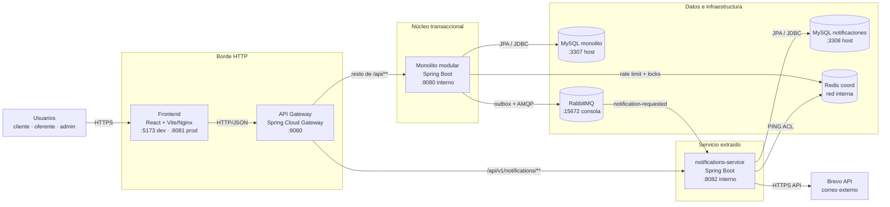
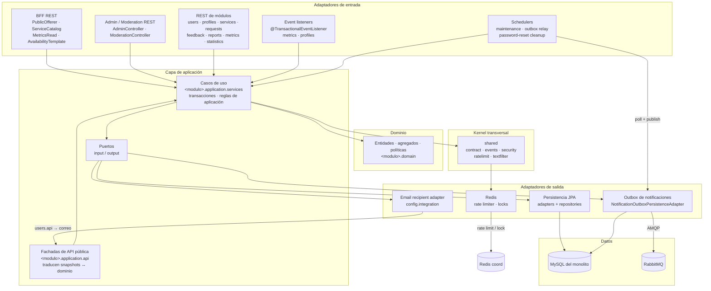
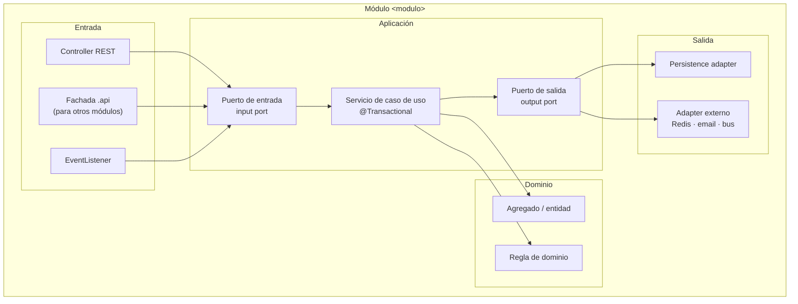
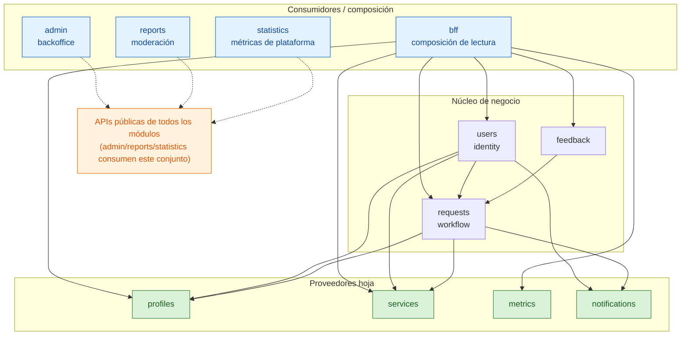
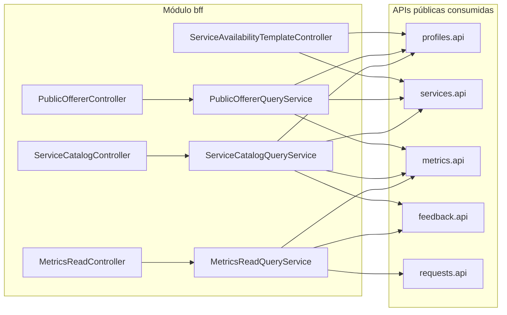
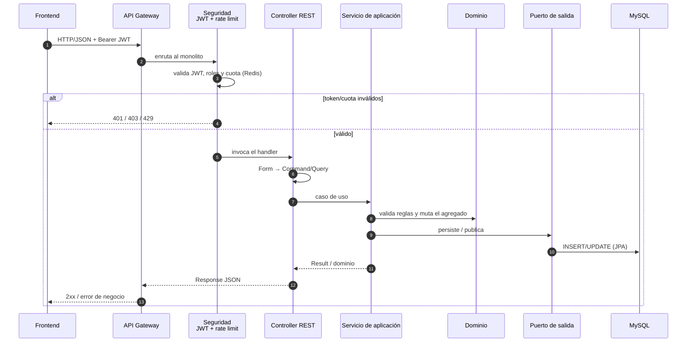
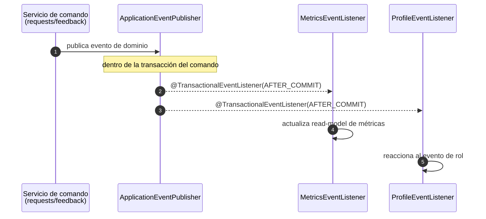
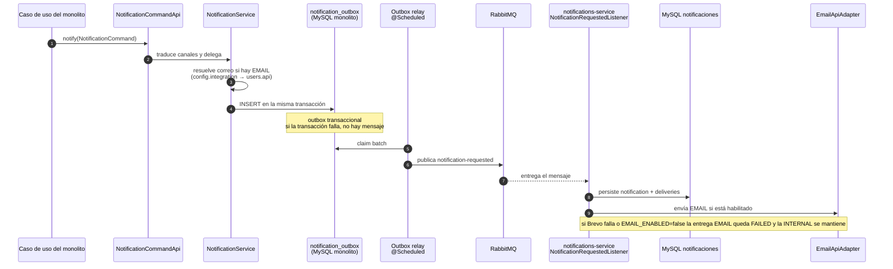
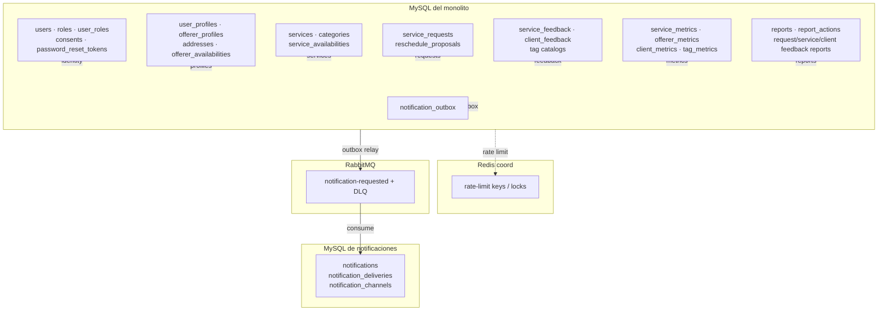

# Componentes y conectores de ServiYa

> Diagramas para entender el monolito modular, sus conectores y el sistema desplegado.
> Fuente de verdad del estado actual: `ESTADO-ACTUAL-Y-PLAN-FUTURO.md` y
> `documents/arquitectura/apis-modulos.md`.
>
> **Cómo renderizarlos:** abre este archivo en GitHub, en VS Code (extensión Mermaid) o pega cada
> bloque en <https://mermaid.live>. Los bloques son independientes.

## Convenciones

- Un **módulo de negocio** publica `com.parosurvivors.serviya.<modulo>.api` (interfaces + DTOs).
- Las llamadas entre módulos son **en proceso**, a través de esas APIs; nunca importan `domain`,
  `infrastructure` ni puertos de persistencia ajenos.
- `metrics`, `notifications`, `profiles` y `services` son **módulos hoja**: solo dependen de `shared`.
- `bff`, `admin`, `reports` y `statistics` son consumidores/orquestadores de lectura o composición.
- `config` es la raíz de composición: cablea implementaciones y adaptadores de integración.
- El grafo de dependencias entre módulos es **acíclico** (`ModuleBoundaryTest`).

## Versiones renderizadas (SVG)

| Diagrama | SVG |
|---|---|
| 1. Vista de contenedores | [01-vista-contenedores.svg](./componentes-y-conectores/01-vista-contenedores.svg) |
| 2. Componentes y conectores del monolito | [02-componentes-conectores-monolito.svg](./componentes-y-conectores/02-componentes-conectores-monolito.svg) |
| 3. Anatomía hexagonal de un módulo | [03-anatomia-hexagonal-modulo.svg](./componentes-y-conectores/03-anatomia-hexagonal-modulo.svg) |
| 4. Grafo de módulos | [04-grafo-modulos.svg](./componentes-y-conectores/04-grafo-modulos.svg) |
| 5. Mapa del BFF | [05-mapa-bff.svg](./componentes-y-conectores/05-mapa-bff.svg) |
| 6. Secuencia de petición HTTP | [06-secuencia-peticion-http.svg](./componentes-y-conectores/06-secuencia-peticion-http.svg) |
| 7. Eventos de dominio | [07-eventos-dominio.svg](./componentes-y-conectores/07-eventos-dominio.svg) |
| 8. Outbox + RabbitMQ | [08-outbox-rabbit.svg](./componentes-y-conectores/08-outbox-rabbit.svg) |
| 9. Mapa de datos | [09-mapa-datos.svg](./componentes-y-conectores/09-mapa-datos.svg) |

---

## 1. Vista de contenedores (runtime)



**Lectura rápida**

- El gateway es el único punto de entrada HTTP del host.
- Solo `notifications-service` está extraído; el resto sigue en el monolito modular.
- El monolito y el servicio de notificaciones **no comparten base de datos**.
- El bus se usa para el flujo de notificaciones; los eventos de dominio internos del monolito son
  in-process.
- Redis se usa para rate limiting/locks en el monolito y para el sondeo de disponibilidad en
  `notifications-service`.

---

## 2. Componentes y conectores del monolito



### 2.1 Anatomía hexagonal de un módulo



**Regla de dependencia**

```text
infrastructure → application → domain
                     ↓
              puertos (interfaces)
```

La infraestructura implementa puertos; el dominio no conoce Spring, JPA ni HTTP.

---

## 3. Grafo de módulos (acíclico)

Las flechas significan “importa la API pública de”. No hay ciclos.



**Módulos hoja:** cualquier dependencia nueva desde `profiles`, `services`, `metrics` o
`notifications` hacia otro módulo de negocio rompe `ModuleBoundaryTest`.

### 3.1 Matriz resumida de dependencias

| Módulo | Puede depender de | Rol |
|---|---|---|
| `users` | `requests`, `profiles`, `services`, `notifications` | identity/auth |
| `requests` | `profiles`, `services`, `notifications` | workflow de solicitudes |
| `feedback` | `requests` | reseñas |
| `profiles` | — (solo `shared`) | perfiles/direcciones |
| `services` | — (solo `shared`) | catálogo propio |
| `metrics` | — (solo `shared`) | read-model por eventos |
| `notifications` | — (solo `shared`) | outbox; el correo lo resuelve `config` |
| `bff` | APIs de users/requests/profiles/services/metrics/feedback | composición HTTP |
| `admin` | APIs de todos los módulos | backoffice |
| `reports` | APIs de todos los módulos | moderación |
| `statistics` | users/requests/feedback/services | métricas de plataforma |

---

## 4. Mapa de composición del BFF

El BFF no tiene dominio propio: solo compone lecturas con APIs públicas y mantiene las URLs/JSON
históricos.



| Endpoint compuesto | Servicio BFF | APIs |
|---|---|---|
| `GET /offerers/{id}/public-profile` | `PublicOffererQueryService` | profiles, metrics, services |
| `GET /offerers/{id}/summary` | `PublicOffererQueryService` | profiles, metrics |
| `GET /services/search` | `ServiceCatalogQueryService` | services, profiles, metrics |
| `GET /services/{id}/detail` | `ServiceCatalogQueryService` | services, profiles, metrics, feedback |
| `GET /offerers/{offererId}/services` | `ServiceCatalogQueryService` | services |
| `POST /service-availabilities/service/{id}/apply-template` | `ServiceAvailabilityTemplateController` | profiles, services |
| `GET /offerers/{id}/tag-metrics` | `MetricsReadQueryService` | metrics, feedback |
| `GET /clients/{id}/tag-metrics` | `MetricsReadQueryService` | metrics, feedback |
| `GET /clients/{id}/metrics` | `MetricsReadQueryService` | metrics, requests |
| `GET /users/me/metrics` | `MetricsReadQueryService` | metrics, requests |

---

## 5. Ciclo de vida de una petición HTTP (escritura)

Ejemplo genérico: `POST /api/v1/...` con JWT.



**Conectores de esta ruta**

- `FE → GW`: HTTP/JSON.
- `GW → backend`: HTTP (Spring Cloud Gateway).
- `SecurityConfig` + `JwtAuthenticationFilter`: autenticación/autorización.
- `RateLimitingFilter` + `RedisRateLimiter`: cuota por IP/email.
- `Controller → Application service`: llamada Java in-process.
- `Application service → Persistence port → JPA adapter`: puerto/adaptador.
- `Application service → domain`: reglas de negocio.

---

## 6. Conectores de eventos: in-process vs outbox

### 6.1 Eventos de dominio internos



Estos eventos **no salen del monolito**; son el mecanismo de desacoplamiento entre módulos para
efectos secundarios (métricas, inicialización de perfiles).

### 6.2 Outbox + RabbitMQ hacia notifications-service



**Propiedades**

- El outbox está en la base del monolito; el relay lo publica de forma asíncrona.
- RabbitMQ tiene una cola principal y una DLQ.
- `notifications-service` es idempotente por `eventId`.
- Si RabbitMQ está caído, la operación de negocio sigue; el outbox reintenta.
- Si Redis está caído, `notifications-service` difiere correos (modo degradado) y el monolito deja
  pasar o rechaza según la política del rate limiter.

---

## 7. Mapa de datos y propiedad



**Regla de oro:** cada módulo es dueño de sus tablas. Ningún módulo accede a la persistencia de
otro; los datos cruzan por APIs o eventos. `notifications-service` tiene su propia base.

---

## 8. Catálogo de conectores

| Conector | Origen → destino | Tecnología | Tipo |
|---|---|---|---|
| Entrada web | Frontend → API Gateway | HTTP/JSON | síncrono |
| Enrutado | API Gateway → monolito / notifications-service | Spring Cloud Gateway | síncrono |
| Seguridad | Gateway → filtros JWT del servicio | JWT Bearer | síncrono |
| Rate limiting | Monolito → Redis | Redis Lua + circuit breaker | síncrono/degradable |
| API entre módulos | Módulo A → `B.api` / fachada | llamada Java in-process | síncrono |
| Composición BFF | BFF → APIs públicas | llamada Java in-process | síncrono |
| Persistencia | Aplicación → puerto → adapter JPA | Spring Data JPA/JDBC | síncrono |
| Evento de dominio | Aplicación → listeners | `ApplicationEventPublisher` | in-process, after-commit |
| Outbox | Aplicación → `notification_outbox` | JPA/MySQL | misma transacción |
| Relay | Relay programado → RabbitMQ | AMQP | asíncrono |
| Consumo | RabbitMQ → notifications-service | AMQP | asíncrono |
| Correo | notifications-service → Brevo | HTTPS API | síncrono externo |
| Coordinación | notifications-service → Redis | PING ACL | síncrono/degradable |
| Datos | Monolito → MySQL | JDBC | síncrono |
| Datos | notifications-service → MySQL propio | JDBC | síncrono |

---

## 9. Inventario de módulos

| Módulo | Responsabilidad principal | Entrada principal | API pública |
|---|---|---|---|
| `users` | cuentas, autenticación, roles, consentimientos, reset | `AuthController`, `AccountController` | `UserQueryApi`, `UserCommandApi`, `UserContactApi` |
| `profiles` | perfiles, direcciones, disponibilidad de oferente | `UserProfileController`, `AddressController`, `OffererProfileController`, `OffererAvailabilityController` | `ProfileQueryApi`, `ProfileCommandApi` |
| `services` | catálogo de servicios y categorías | `ServiceController`, `CategoryController`, `ServiceAvailabilityController` | `ServiceQueryApi`, `ServiceCommandApi` |
| `requests` | solicitudes, estados, reprogramaciones, historial | `ServiceRequestController`, `RescheduleProposalController` | `RequestQueryApi`, `RequestCommandApi`, `RequestLookupApi`, `RequestCountApi` |
| `feedback` | feedback de servicio y de cliente, catálogo de tags | `ServiceFeedbackController`, `ClientFeedbackController` | `FeedbackQueryApi`, `FeedbackCommandApi` |
| `metrics` | read-model de métricas por eventos | `MetricsController`, listeners | `MetricsQueryApi` |
| `notifications` | outbox, bandeja y entregas | `NotificationCommandApi`, relay | `NotificationCommandApi` |
| `reports` | reportes, acciones de moderación | `ReportController` | `ReportQueryApi`, `ReportCommandApi` |
| `admin` | backoffice: usuarios, roles, moderación | `AdminController`, `ModerationController` | — (consumidor) |
| `statistics` | métricas agregadas de plataforma | `StatisticsController` | — (consumidor) |
| `bff` | composición de lecturas públicas/admin | controllers del BFF | — (consumidor) |
| `shared` | kernel: contratos, eventos, seguridad, rate limit, text filter | — | `shared.contract`, `shared.events` |
| `config` | raíz de composición e integración | — | — |

---

## 10. Lectura recomendada

1. **Vista de contenedores** para entender qué se despliega.
2. **Componentes y conectores del monolito** para ver las capas y los adaptadores.
3. **Grafo de módulos** para entender la dirección de dependencias y los módulos hoja.
4. **Mapa del BFF** para ver dónde se componen las lecturas cross-module.
5. **Secuencias** para seguir una petición y un evento de notificación.
6. **Mapa de datos** para ubicar la propiedad de cada tabla.

> Si estos diagramas y el código discrepan, el código y `ModuleBoundaryTest` son la fuente de
> verdad; actualiza los diagramas en el mismo commit que el cambio arquitectónico.
